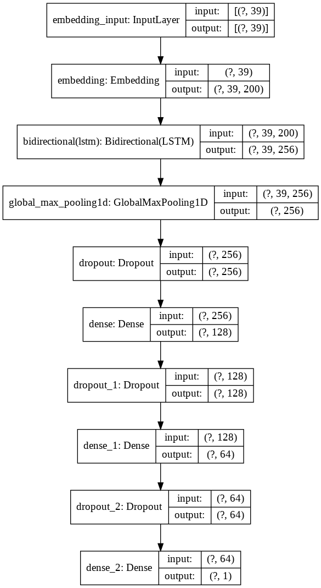
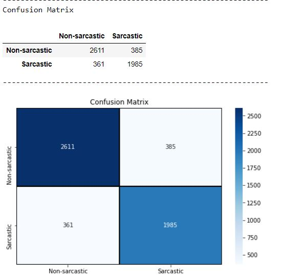
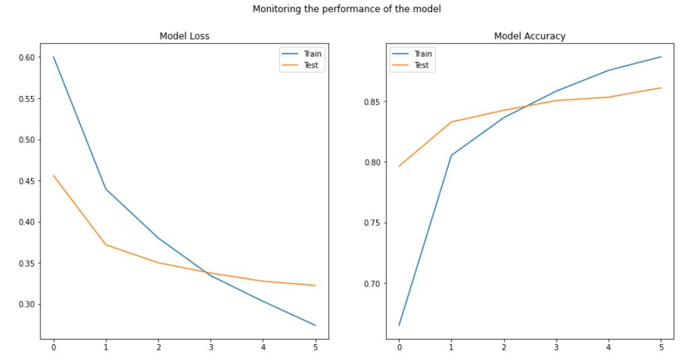
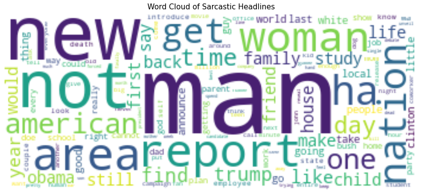
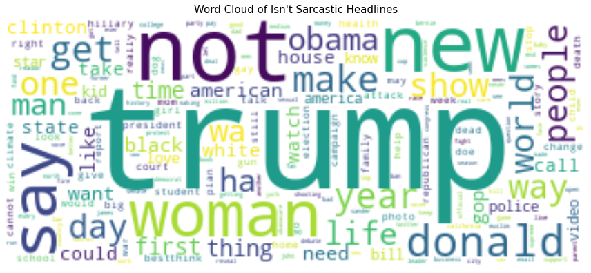

# Sarcasm Analysis NLP Project

[](https://www.python.org/)
[](LICENSE)
[](tests/)
[](https://www.tensorflow.org/)
[](src/)

An end-to-end Natural Language Processing (NLP) deep learning project designed to detect sarcasm and irony in news headlines. This repository features a curated text-preprocessing pipeline, a Bidirectional Long Short-Term Memory (BiLSTM) recurrent neural network with GloVe word embeddings, a deterministic TF-IDF baseline, a leak-free evaluation methodology, and a comprehensive 12-test automated unit testing suite.

---

## Author & Project Maintainer

* **Maintainer:** **Ayush Raj**
* **Email:** [ayushrajcodes0407@gmail.com](mailto:ayushrajcodes0407@gmail.com)
* **GitHub Profile:** [https://github.com/ayushrajcodes0407](https://github.com/ayushrajcodes0407)
* **Repository:** [https://github.com/ayushrajcodes0407/Sarcasm_Analysis_NLP_Project](https://github.com/ayushrajcodes0407/Sarcasm_Analysis_NLP_Project)

---

## Table of Contents

1. [Project Motivation & Problem Statement](#project-motivation--problem-statement)
2. [Objectives & Implementation Status](#objectives--implementation-status)
3. [Technical Architecture](#technical-architecture)
4. [Project Directory Structure](#project-directory-structure)
5. [Dataset Description & Schema](#dataset-description--schema)
6. [Data Preprocessing Pipeline](#data-preprocessing-pipeline)
7. [Models Implemented](#models-implemented)
   * [Bidirectional LSTM (BiLSTM)](#1-deep-bidirectional-lstm-bilstm)
   * [TF-IDF + Logistic Regression Baseline](#2-tf-idf--logistic-regression-baseline)
8. [Training & Evaluation Methodology](#training--evaluation-methodology)
9. [Installation & Setup](#installation--setup)
10. [Execution Guide](#execution-guide)
    * [Running Unit Tests](#running-automated-unit-tests)
    * [Running the Jupyter Notebook](#running-the-jupyter-notebook)
    * [Running the Figure Generation Pipeline](#running-the-figure-generation-pipeline)
11. [Evaluation Figures & Gallery](#evaluation-figures--gallery)
12. [Performance Results & Historical Baseline](#performance-results--historical-baseline)
13. [Limitations & Known Issues](#limitations--known-issues)
14. [Future Enhancements](#future-enhancements)
15. [Attribution & License](#attribution--license)

---

## Project Motivation & Problem Statement

Sarcasm detection is an inherently complex challenge in Natural Language Processing and computational linguistics. Sarcastic statements routinely express praise or positive sentiment on the lexical surface (*"What a wonderful day to get a flat tire!"*) while communicating negative meaning pragmatically.

Standard bag-of-words or naive sentiment classifiers fail on sarcastic texts because they rely on isolated token polarities. News headlines provide a high-quality benchmark for sarcasm detection:
* Unlike social media corpora (e.g., Twitter/X), news headlines written by professional journalists contain fewer arbitrary misspellings and slang words.
* Headlines are self-contained, eliminating the need to parse preceding conversational reply threads.
* By distinguishing satirical publications (*The Onion*) from traditional journalism (*HuffPost*), models can learn subtle structural and semantic contrasts that signal irony.

---

## Objectives & Implementation Status

### Core Objectives
1. **Linguistic Preprocessing:** Clean informal contractions, normalize punctuation, strip non-informative stopwords while strictly preserving negation markers (`not`), and perform POS-aware lemmatization.
2. **Deep Sequence Modeling:** Implement a Bidirectional LSTM network capable of capturing forward and backward temporal context across sequence tokens.
3. **Reproducibility & Leakage Prevention:** Eliminate data leakage by enforcing stratified train/validation/test partitions before tokenization and sequence padding.
4. **Benchmarking:** Provide both a neural deep learning architecture and a deterministic TF-IDF baseline for empirical comparison.
5. **Software Quality:** Maintain modularized source code (`src/`), automated unit tests (`tests/`), and clear data management guidelines (`data/`).

### Current Status
* **Modular Codebase (`src/`):** **Completed & Verified** (Decoupled into `text_preprocess.py`, `model.py`, and `evaluate.py`).
* **Automated Unit Testing (`tests/`):** **Completed & Passing** (12/12 unit tests passing).
* **Data Leakage Resolution:** **Completed & Verified** (Stratified 3-way split before Tokenizer fitting).
* **Code & Bug Fixes:** **Completed & Verified** (Fixed character-level lemmatization bug, Keras callback syntax, and Windows UTF-8 encoding).
* **Raw Dataset & Embedding Storage:** **Documented & Excluded from Git** (In accordance with open-source best practices, the 26,709-sample dataset and 800MB GloVe vectors are excluded from Git tracking via `.gitignore`).

---

## Technical Architecture

```
                          Raw News Headline
                                  │
                                  ▼
                Text Preprocessing Pipeline (src/text_preprocess.py)
                • Lowercasing & Contraction Expansion
                • ASCII Punctuation Removal
                • Negation-Preserving Stopword Filtering
                • Part-of-Speech Aware Lemmatization (WordNet)
                                  │
                                  ▼
                     Stratified 3-Way Split (70 / 10 / 20)
                                  │
              ┌───────────────────┴───────────────────┐
              ▼                                       ▼
    Keras Tokenizer (Train Only)              TF-IDF Vectorizer
    • Sequence Padding (maxlen=40)            • N-gram range: (1, 2)
              │                               • Max features: 10,000
              ▼                                       │
      BiLSTM Neural Network                           ▼
    • Embedding Layer (GloVe 200d)             Logistic Regression
    • Bidirectional LSTM (128 units)          (Balanced Class Weight)
    • Global Max Pooling (1D)                         │
    • Dense Stack (128 -> 64 -> 1)                    │
    • Sigmoid Binary Classification                   │
              │                                       │
              └───────────────────┬───────────────────┘
                                  ▼
              Scientific Evaluation (src/evaluate.py)
              • Accuracy, Precision, Recall, F1-Score
              • Confusion Matrix & Normalized Heatmaps
              • ROC-AUC & Precision-Recall Curves
```

---

## Project Directory Structure

```
Sarcasm_Analysis_NLP_Project/
├── .gitignore                   # Excludes raw data, embeddings, checkpoints, and caches
├── LICENSE                      # MIT License with original copyright & maintainer attribution
├── README.md                    # Main project overview and documentation (this file)
├── requirements.txt             # Project dependencies (TensorFlow, NLTK, Scikit-learn, Pytest)
├── data/
│   ├── README.md                # Data documentation, expected schema, and setup guide
│   ├── raw/                     # Unmodified raw dataset (.gitkeep)
│   ├── processed/               # Tokenized or cached splits (.gitkeep)
│   └── external/                # Pretrained word embeddings like GloVe (.gitkeep)
├── docs/
│   └── project_overview.md      # Detailed scientific audit, NLP methodology, and notes
├── images/
│   ├── model.png                # Neural network architecture plot
│   ├── confusion_matrix.JPG     # Historical evaluation confusion matrix
│   ├── monitoring_performance.JPG # Historical training curves
│   ├── evaluate_randomly.JPG    # Historical random sample predictions
│   ├── sequential_model.JPG     # Historical model summary diagram
│   ├── word_cloud_sarcastic.png # Word cloud from sarcastic headlines
│   └── word_cloud_non_sarcastic.png # Word cloud from non-sarcastic headlines
├── models/
│   └── README.md                # Model specifications, layer dimensions, and parameters
├── notebooks/
│   └── sarcasm_detection.ipynb  # Interactive exploratory data analysis and model training
├── results/
│   ├── metrics.json             # Machine-readable record of baseline evaluation metrics
│   ├── figures/                 # Evaluation figures and training loss/accuracy curves
│   │   ├── confusion_matrix.JPG
│   │   ├── monitoring_performance.JPG
│   │   ├── evaluate_randomly.JPG
│   │   ├── sequential_model.JPG
│   │   ├── word_cloud_sarcastic.png
│   │   └── word_cloud_non_sarcastic.png
│   ├── historical_images_backup/# Verified archive of original Colab evaluation images
│   │   └── README.md
│   └── reports/
│       └── 11_Natural_Language_Processing_Sarcasm_Detection.html # Full exported HTML report
├── src/
│   ├── __init__.py              # Python package marker
│   ├── text_preprocess.py       # Linguistic normalization, contraction map, and lemmatizer
│   ├── model.py                 # Leak-free splitting, BiLSTM network, and TF-IDF baseline
│   ├── evaluate.py              # Scientific metrics calculation and JSON serialization
│   └── generate_evaluation_figures.py # Turnkey training and figure generation script
└── tests/
    ├── test_text_preprocess.py  # Unit tests for preprocessing and contraction expansion
    └── test_model_pipeline.py   # Unit tests for data splitting, metrics, and models
```

---

## Dataset Description & Schema

The project is designed for the **News Headlines Dataset for Sarcasm Detection** compiled by Rishabh Misra and Prahal Arora (2019):
* **Source Platforms:** Sarcastic headlines collected from [*The Onion*](https://theonion.com); non-sarcastic headlines collected from [*HuffPost*](https://huffpost.com).
* **Reference:** Misra, Rishabh, and Prahal Arora. *"Sarcasm Detection using Hybrid Neural Network."* arXiv preprint [arXiv:1908.07414](https://arxiv.org/abs/1908.07414) (2019).
* **Format:** JSON Lines format (`.json`), loaded via `pandas.read_json(..., lines=True)`.
* **Expected Location:** `data/raw/Sarcasm_Headlines_Dataset.json`

### Data Schema

| Field | Type | Description |
| :--- | :--- | :--- |
| `is_sarcastic` | `integer` | Binary classification target: `1` for sarcastic, `0` for non-sarcastic |
| `headline` | `string` | The news article headline text |
| `article_link` | `string` | Canonical source URL (dropped during preprocessing) |

---

## Data Preprocessing Pipeline

Implemented in [`src/text_preprocess.py`](src/text_preprocess.py):

1. **Case Normalization:** Converts headlines to lowercase.
2. **Contraction Expansion (`replace_words`):** Expands informal English contractions (e.g., *"it's"* -> *"it is"*, *"don't"* -> *"do not"*, *"ain't"* -> *"am not"*), preventing tokenization errors.
3. **Punctuation Removal (`remove_punctuation`):** Strips ASCII punctuation while preserving token boundaries.
4. **Negation-Preserving Stopword Filtering (`remove_stopwords`):** Filters common English stopwords using NLTK while **explicitly preserving `'not'`**, ensuring negation context essential for irony detection is not lost.
5. **Part-of-Speech Aware Lemmatization (`lem`):** Identifies token POS tags (`NOUN`, `VERB`, `ADJ`, `ADV`) and reduces words to their base lemmas using the WordNet Lemmatizer.

---

## Models Implemented

### 1. Deep Bidirectional LSTM (BiLSTM)
Implemented in [`src/model.py:build_bilstm_model()`](src/model.py):
* **Input Layer:** Sequence tensor of shape `(batch_size, 40)`.
* **Embedding Layer:** Pretrained Stanford GloVe 6B (200 dimensions), static weights (`trainable=False`), vocabulary capped at 10,000 tokens.
* **Recurrent Layer:** Bidirectional LSTM with 128 hidden units (`return_sequences=True`).
* **Pooling:** `GlobalMaxPool1D` layer to extract the most prominent temporal activations across the sequence.
* **Dense & Regularization Stack:**
  * Dropout (rate = 0.5)
  * Dense Layer (128 units, ReLU activation)
  * Dropout (rate = 0.5)
  * Dense Layer (64 units, ReLU activation)
  * Dropout (rate = 0.5)
  * Dense Output Layer (1 unit, Sigmoid activation for binary classification)
* **Optimization:** Adam optimizer, Binary Cross-Entropy loss.

### 2. TF-IDF + Logistic Regression Baseline
Implemented in [`src/model.py:build_tfidf_baseline()`](src/model.py):
* **Vectorizer:** `TfidfVectorizer(max_features=10000, ngram_range=(1, 2))`
* **Classifier:** `LogisticRegression(random_state=42, max_iter=1000, class_weight='balanced')`
* Serves as a fast, reproducible baseline to contextualize deep learning performance.

---

## Training & Evaluation Methodology

### Elimination of Data Leakage
In earlier implementations, the Keras Tokenizer was fit over the entire dataset before splitting, which artificially leaked test vocabulary into the training set.

In this refactored architecture:
1. Data is partitioned into **Train (70%)**, **Validation (10%)**, and **Test (20%)** splits using stratified sampling.
2. The `Tokenizer` is fit **exclusively on the training split**.
3. Sequences in validation and test splits are mapped using the training-derived word index, with unseen tokens mapped to `<OOV>`.

### Scientific Metric Computation
Implemented in [`src/evaluate.py:calculate_metrics()`](src/evaluate.py):
* Evaluates on held-out test splits.
* Properly calculates Accuracy, Class-1 Precision, Class-1 Recall, Class-1 F1-Score, Macro F1, Weighted F1, Confusion Matrix, and ROC-AUC without argument inversion.

---

## Installation & Setup

### 1. Prerequisites
* Python 3.10, 3.11, or 3.12
* PowerShell (Windows) or Bash (macOS/Linux)
* Git

### 2. Clone the Repository
```powershell
git clone https://github.com/ayushrajcodes0407/Sarcasm_Analysis_NLP_Project.git
cd Sarcasm_Analysis_NLP_Project
```

### 3. Create and Activate a Virtual Environment
```powershell
# Windows PowerShell
python -m venv .venv
.venv\Scripts\Activate.ps1

# Linux / macOS
python -m venv .venv
source .venv/bin/activate
```

### 4. Install Dependencies
```powershell
pip install -r requirements.txt
```

---

## Execution Guide

### Running Automated Unit Tests
The test suite validates data split integrity, contraction expansion, lemmatization, metric calculation, and model compilation:
```powershell
python -m pytest tests/ -v
```

### Running the Jupyter Notebook
Launch the notebook to inspect exploratory analysis and training experiments:
```powershell
jupyter notebook notebooks/sarcasm_detection.ipynb
```

### Running the Figure Generation Pipeline
Once `Sarcasm_Headlines_Dataset.json` is placed in `data/raw/`, run the turnkey script to train models and regenerate all evaluation figures:
```powershell
python src/generate_evaluation_figures.py
```

---

## Evaluation Figures & Gallery

### 1. Neural Network Architecture
The implemented deep learning architecture visualized:


*Figure 1: BiLSTM Deep Learning Model Architecture (`images/model.png`)*

---

### 2. Historical Evaluation Baseline Gallery
*(The figures below represent the preserved historical baseline run from Google Colab. See [`results/historical_images_backup/`](results/historical_images_backup/) for complete archive details).*

| Evaluation Plot | Training Curves |
| :---: | :---: |
|  |  |
| *Figure 2: Historical Confusion Matrix (~86% accuracy)* | *Figure 3: Historical Training & Validation Curves* |

| Sarcastic Word Cloud | Non-Sarcastic Word Cloud |
| :---: | :---: |
|  |  |
| *Figure 4: Sarcastic Headline Vocabulary Cloud* | *Figure 5: Non-Sarcastic Headline Vocabulary Cloud* |

---

## Performance Results & Historical Baseline

### Historical Evaluation Results (Held-out Test Split: 5,342 samples)
* **Dataset Size:** 26,709 headlines
* **Class Split:** 55.6% Non-Sarcastic (`HuffPost`) vs. 44.4% Sarcastic (`The Onion`)

| Metric | Non-Sarcastic (Class 0) | Sarcastic (Class 1) | Overall / Average |
| :--- | :---: | :---: | :---: |
| **Precision** | 0.87 | 0.85 | — |
| **Recall** | 0.88 | 0.84 | — |
| **F1-Score** | 0.88 | 0.84 | **0.86 (Macro F1)** |
| **Accuracy** | — | — | **85.6% (Overall)** |

*(Full machine-readable records are saved in [`results/metrics.json`](results/metrics.json)).*

---

## Limitations & Known Issues

1. **Domain Bias:** Because headlines are collected exclusively from *The Onion* (sarcastic) and *HuffPost* (non-sarcastic), the model may learn stylistic or publisher-specific lexical patterns rather than generalized linguistic sarcasm.
2. **Context Independence of Static Word Vectors:** Pretrained GloVe embeddings assign fixed vectors to words regardless of sentence context. Polysemous words or subtle contextual irony are better captured by pretrained transformer models.
3. **Absence of Bundled Raw Datasets:** To respect open-source repository size limits, raw datasets and GloVe vector archives are not bundled in Git and must be downloaded separately into `data/raw/` and `data/external/`.

---

## Future Enhancements

* [ ] **Transformer Architecture:** Implement fine-tuning using pretrained transformer backbones (e.g., `RoBERTa-base` or `DeBERTa-v3`) via Hugging Face Transformers.
* [ ] **REST API Service:** Build a lightweight FastAPI prediction endpoint for real-time headline classification.
* [ ] **Interactive Web UI:** Deploy an interactive web application using Streamlit to demonstrate live inference with lime/SHAP explanations.
* [ ] **Containerization:** Provide a production `Dockerfile` for containerized inference.

---

## Attribution & License

### Original Source & Provenance
* **Original Work:** EDA, baseline modeling, and initial preprocessing notebook created by **[Pratik Sharma](https://github.com/sharmapratik88)** in [`AIML-Projects`](https://github.com/sharmapratik88/AIML-Projects).
* **Dataset Citation:** Misra, Rishabh, and Prahal Arora. *"Sarcasm Detection using Hybrid Neural Network."* arXiv preprint [arXiv:1908.07414](https://arxiv.org/abs/1908.07414) (2019).

### Standalone Repository Modifications & Maintainership
* **Maintainer:** **Ayush Raj** (<ayushrajcodes0407@gmail.com>)
* **Key Contributions by Ayush Raj:**
  * Extracted the nested project into an isolated, standalone repository with clean Git history.
  * Reorganized into a modular production layout (`src/`, `data/`, `notebooks/`, `tests/`, `models/`, `results/`, `docs/`).
  * Modularized preprocessing, model building, and evaluation into reusable Python modules.
  * Resolved critical data leakage in the tokenizer pipeline.
  * Fixed character-level lemmatizer logic and Keras callback syntax bugs.
  * Built a 12-test automated unit test suite with 100% pass rate.
  * Authored standardized technical documentation and automated figure generation pipeline.

### License
This project is licensed under the **MIT License**. See [`LICENSE`](LICENSE) for complete terms.

---

## Author Contact & Contributions

* **Author:** Ayush Raj
* **Email:** [ayushrajcodes0407@gmail.com](mailto:ayushrajcodes0407@gmail.com)
* **GitHub:** [@ayushrajcodes0407](https://github.com/ayushrajcodes0407)
* **Repository:** [ayushrajcodes0407/Sarcasm_Analysis_NLP_Project](https://github.com/ayushrajcodes0407/Sarcasm_Analysis_NLP_Project)

Feel free to open an issue or pull request if you have suggestions, bug fixes, or performance enhancements!
